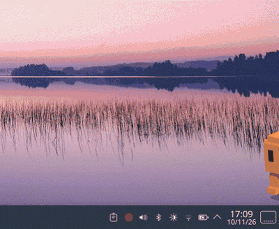
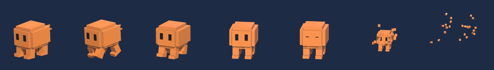

# Clawd Widget

Drück die **Copilot-Taste**, und Clawd läuft unten rechts über deinen Bildschirm und fragt, womit er starten soll: **Claude Code**, **Claude Desktop** oder **Claude im Browser**.



Clawd erscheint über allen offenen Fenstern, wartet auf deine Auswahl und verpufft danach in kleine Würfel. Solange er nicht gebraucht wird, läuft nichts im Hintergrund.

> **Inoffizielles Fan-Projekt.** Nicht von Anthropic und nicht mit Anthropic verbunden. „Claude“ und „Clawd“ sind Marken bzw. Figuren von Anthropic.

## Funktionen

- Startet mit der **Copilot-Taste** (auf neueren Laptops unten rechts neben Alt Gr)
- Läuft schräg ins Bild, dreht sich zu dir und blinzelt
- **Claude Code** öffnet Konsole mit `claude` in einem Ordner deiner Wahl
- **Claude Desktop** startet die App, wenn `claude-desktop` installiert ist (sonst ausgegraut)
- **Claude im Browser** öffnet [claude.ai](https://claude.ai) im Standardbrowser
- Verpufft nach einer Auswahl, mit **Esc**, mit einem **zweiten Druck** auf die Copilot-Taste oder nach **10 Sekunden** ohne Auswahl
- Beendet sich danach komplett, braucht also im Ruhezustand **keinen Arbeitsspeicher**



## Voraussetzungen

| | |
|---|---|
| Desktop | **KDE Plasma 6** unter **Wayland** |
| Python | Python 3 mit **PySide6** |
| Terminal | Konsole |
| Claude | [Claude Code](https://github.com/anthropics/claude-code) für den ersten Button |

Getestet auf Fedora 44 mit Plasma 6.7. Andere Distributionen mit Plasma 6 sollten funktionieren, sind aber nicht getestet.

PySide6 installieren, falls es fehlt:

```bash
# Fedora
sudo dnf install python3-pyside6
# Arch
sudo pacman -S pyside6
# andere: pip install --user PySide6
```

## Installation

```bash
git clone https://github.com/WKell04/clawd-widget.git
cd clawd-widget
./install.sh
```

Danach **einmal ab- und wieder anmelden**, damit die Copilot-Taste erkannt wird (Grund siehe [Copilot-Taste](#warum-ab--und-wieder-anmelden)).

Optionen:

```bash
./install.sh --code-dir ~/dev/projects   # Ordner, in dem Claude Code startet (Standard: Home)
./install.sh --remove                    # alles wieder entfernen
```

Den Ordner nach dem Installieren nicht verschieben. Der Starter zeigt auf den Pfad, an dem `install.sh` ausgeführt wurde. Wenn du ihn doch verschiebst, führ `./install.sh` danach erneut aus.

### Was `install.sh` einrichtet

| Was | Wo | Wozu |
|---|---|---|
| Starter | `~/.local/share/applications/clawd-widget.desktop` | KDE kennt das Programm und kann ein Kürzel daran hängen |
| KWin-Fensterregel | `~/.config/kwinrulesrc` | Fenster immer im Vordergrund, unten rechts, nicht in Taskleiste/Alt+Tab |
| Tastatur-Korrektur | `~/.config/xkb/` und `~/.config/kxkbrc` | Copilot-Taste für KDE erkennbar machen |
| Tastenkürzel | `~/.config/kglobalshortcutsrc` | Copilot-Taste startet Clawd |

Es werden keine Systemdateien verändert und kein `sudo` benötigt. `./install.sh --remove` nimmt alles zurück.

## Anpassen

- **Anderes Tastenkürzel:** Systemeinstellungen → Tastatur → Tastenkürzel → *Clawd*. Dort kannst du jede beliebige Taste festlegen, z. B. wenn dein Gerät keine Copilot-Taste hat.
- **Anderer Ordner für Claude Code:** `./install.sh --code-dir <ordner>` erneut ausführen.
- **Position:** Clawd erscheint unten rechts auf dem Hauptbildschirm, über einer Taskleiste am unteren Rand. Nach einem Wechsel des Bildschirms oder der Skalierung `./install.sh` erneut ausführen.
- **Texte, Timeout, Laufweg:** Konstanten oben in [`clawd_widget.py`](clawd_widget.py).

## So funktioniert's

```
clawd.blend ──render_sprites.py──▶ assets/*.png ──clawd_widget.py──▶ Fenster auf dem Desktop
 (Blender)                         (94 Bilder)        (PySide6/Qt)
```

1. **Modell:** Clawd ist ein Voxel-Modell in Blender ([`clawd.blend`](clawd.blend)) mit den Animationen `walk`, `idle` und `poof`. Eine glTF-Version liegt als [`clawd.glb`](clawd.glb) bei, falls du ihn in 3D weiterverwenden willst (z. B. mit Three.js).
2. **Sprites:** [`render_sprites.py`](render_sprites.py) rendert daraus 94 transparente PNG-Bilder aus einem festen Kamerawinkel. Dazu kommt eine Dreh-Animation `turn`, in der sich Clawd zur Kamera dreht.
3. **Widget:** [`clawd_widget.py`](clawd_widget.py) ist ein rahmenloses, transparentes Qt-Fenster, das die Bilder abspielt und die Sprechblase zeichnet. Statt echtem 3D werden nur Bilder abgespielt. Das hält das Programm klein und schnell.
4. **Platzierung:** Unter Wayland dürfen Programme ihre Fensterposition nicht selbst bestimmen. Deshalb übernimmt eine **KWin-Fensterregel** Position und „immer im Vordergrund“.
5. **Zweiter Tastendruck:** Läuft Clawd schon, schickt der zweite Start ihm über einen lokalen Socket ein „poof“ und beendet sich sofort.

### Sprites neu rendern

Wenn du das Modell in Blender veränderst:

```bash
blender -b clawd.blend -P render_sprites.py
```

Die `.blend`-Datei wird dabei nicht verändert. Getestet mit Blender 5.2.

## Fehlerbehebung

### Die Copilot-Taste macht nichts

Die Copilot-Taste sendet **Meta + Shift + F23**. Im Standard-Tastaturlayout von Linux wird Shift+F23 aber zu `XF86Assistant`. Diese Taste kennt KDE nicht, deshalb zeigt der Kürzel-Dialog nur „Meta+Shift“. `install.sh` legt deshalb eine kleine Layout-Ergänzung an (`~/.config/xkb/symbols/clawd`), die F23 auch mit Shift als F23 belässt.

#### Warum ab- und wieder anmelden?

KWin lädt das Tastaturlayout nur beim Anmelden neu. Ob es aktiv ist, kannst du z. B. auf [keycode.info](https://www.toptal.com/developers/keycode) prüfen: Bei der Copilot-Taste sollte `event.key` **F23** sein, nicht `Unidentified`.

Falls `~/.config/xkb/rules/evdev` schon eigene Regeln enthält, überschreibt `install.sh` die Datei nicht. Füge dann am Ende selbst ein:

```
! option = symbols
  clawd:f23 = +clawd(f23)
```

Wichtig: Die Zeile `! include %S/evdev` muss **davor** stehen, sonst wird die Korrektur wieder überschrieben.

### Clawd erscheint an der falschen Stelle

`./install.sh` erneut ausführen. Es liest Bildschirmgröße, Skalierung und Taskleiste neu aus. Bei mehreren Monitoren nimmt es den Hauptbildschirm.

### Clawd erscheint, aber Esc geht nicht

Die KWin-Regel erlaubt dem Fenster, den Fokus zu bekommen. Prüfe unter Systemeinstellungen → Fensterverwaltung → Fensterregeln, ob die Regel *Clawd widget* aktiv ist.

## Lizenz

[MIT](LICENSE). Clawd und Claude sind Eigentum von Anthropic. Dieses Projekt ist eine inoffizielle Fan-Arbeit.
